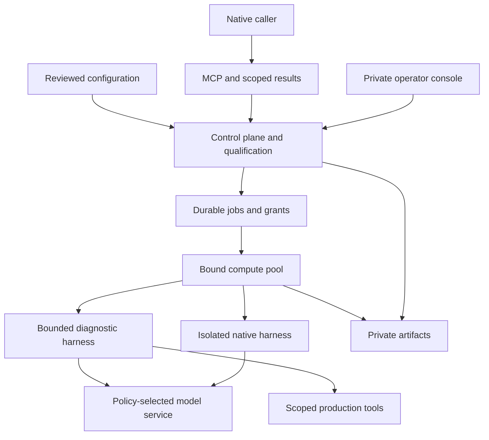

# Sovite — a provisioned platform for mixed model and agent estates

19 October 2026 · revised from the Tulli proposal; class-aware delivery and subscription bindings updated 22 October 2026

## Product decision

Build the complete operating platform and assess it through sustained use. The release includes serving bindings, native and specialist harnesses, agent packages, compute placement, private state, delegation, qualification, operational controls and an operator console. Installation, configuration changes, failure handling and recovery belong to the product from the outset.

The useful question is whether operating this installation improves the work: can a native cloud assistant delegate restricted tasks to a capable private agent, can the operator understand and change the resolved setup, and can the system retain its boundaries through an outage or replacement? Individual checks support that assessment. They do not determine the product's initial scope.

After using the whole, remove components whose operational contribution does not justify their maintenance. Preserve their interfaces and exportable state so simplification does not require rebuilding the estate.

## Name

**Sovite Platform** is the working name. The fitting between parts is the central product idea: a model, serving engine, harness, agent package, host and policy can be selected independently, then bound into an explicit operating combination.

Tulli described the flow-control responsibility well, but made customs and crossings sound like the whole product. The revised platform also provisions workloads, manages their lifecycle and supports day-to-day operations. Telakka and Laituri were considered for their assembly and infrastructure meaning; both have adjacent public Docker tooling names. Sovite also has existing software uses, so the working name is an architectural choice rather than a claim to an available public brand or package namespace.

The display name is configurable. The source package, command and environment prefix in this release are `sovite`, `sovite` and `SOVITE_`.

## Thesis

Sovite assembles a mixed agent estate from replaceable packages and owns the resolved deployment and operating contract. It keeps the native harness visible, treats information placement as a first-class constraint, and gives operators a complete workflow for installing, changing, observing and recovering the system.

A caller can keep its native environment and delegate a bounded task through MCP. Installed grants select the agent, model, tools, execution and state destinations. These bindings can use private or public model services where the declared data class permits the crossing; restricted inputs require private-boundary inference. The caller receives an independent receipt and can receive content only under the installed result contract, output class and current reader authority.

A specialist Kubernetes agent is another package in the same installation. Its model can be fine-tuned or general-purpose, and its harness can be independently developed. The platform records the actual combination, restricts its declared tool authority and directs work to its configured compute pool. Model competence remains something to establish against the intended task.

## The separation to preserve

The data-platform analogy is useful because durable state and replaceable execution have different lifecycles. The database and artifact store outlive API instances, worker processes and model-serving pods. A serving pool can be replaced without moving the job ledger. An agent package can change without owning the GPU scheduler. A native caller does not need to adopt the private agent's harness.

Some layers remain coupled by their interfaces. A model's tool behavior affects the harness; a serving API must preserve the protocol the harness uses; memory and context requirements constrain compute placement. Sovite exposes those dependencies and qualifies resolved combinations. It does not promise that arbitrary combinations behave equivalently.

| Package or binding | Independently configured content | Compatibility that must remain explicit |
| --- | --- | --- |
| Model | Identifier, model name, parameters and supported content or provider-service identity | Context requirements, tool behavior, reasoning behavior and intended task quality; provider identity does not prove immutable weights |
| Serving | Adapter, protocol, endpoint and destination | Streaming and continuation semantics; model identity behind the endpoint |
| Harness | Kind, image/digest, version, capability declarations and service interface | Native tools, state lifecycle, cancellation and provider protocol |
| Agent | Harness/model references, instructions, allowed tools and execution bounds | The actual procedure and authority available to the agent |
| Compute | Pool identity, deployment kind, namespace and resource profile | Available resources, isolation and destination clearance |
| State | Database and artifact-store placement | Durability, privacy, recovery and qualification binding |
| Flow grant | Caller, agent, class, compute, destinations and return behavior | Current authority at admission, execution and release |

Model weights remain in the serving system's managed cache or provisioned model volume. Workload images use normal container packaging. The first release records those bindings and verifies supported model identities; it does not provide a second general-purpose OCI registry implementation.

## Caller discovery and external preferences

Caller-scoped discovery exposes installed candidate declarations and labelled current
policy facts under an installed metadata class and caller clearance. It creates no
reservation or live-account qualification. Preferences and spending decisions remain
with the coordinator; a declared interactive authentication path does not establish
human presence or effect authority. Attempt lineage records provenance separately
from authorized artifact reuse. See [the concrete contract](CALLER-DISCOVERY.md).

## Release architecture



The diagram describes responsibilities. A local assessment can place several services on one host; the private distribution separates them into services or pods. Placement claims become meaningful only when the target's actual resources and network controls have been observed.

### Control plane

The control API imports a validated `PlatformBundle` into durable revision storage. It exposes the operator application and a deliberately small caller surface. The database holds jobs, leases, configuration revisions, runtime inhibits, sessions, qualifications and audit records. Private result bodies are stored through a filesystem or S3 backend.

The resolved job snapshot includes its grant, agent, model, harness, tools, compute and destinations. A canonical generation digest covers the declared bundle. Signed qualifications also bind nonsecret runtime settings, including the actual database target, artifact placement, public origin and security settings. Moving those services invalidates an existing qualification. Credential rotation does not require recording secrets in the evidence.

The implementation uses a shared database-backed job queue and transactional state transitions. Workers claim only their configured compute pool. A lease prevents a late or duplicate worker from publishing a result after ownership has moved. Jobs are claimed oldest first, but a model's `max_concurrency` caps how many of its jobs run at once; a worker passes over a job whose model is at its limit and takes the next job for another model. With more than one worker, a slow model therefore cannot hold every worker while jobs for a faster model wait. On PostgreSQL, claims serialize on an advisory lock so concurrent workers cannot both see the same free slot.

### Execution plane

Ollama provides local model serving. The diagnostic harness implements a bounded tool-calling procedure over configured model endpoints and an explicit tool allowlist. Fixed native services support Codex, Claude Code and OpenCode, with explicit provider and credential bindings, their own small durable execution ledger and no control-plane database, artifact or operator credentials. New subscription and Go launchers produce answers in fresh task directories with native tools denied; they do not yet provide a repository editing session.

The agent's `max_steps` setting bounds iterations in the diagnostic `tool-agent` harness. Native CLIs retain their own internal task loops; Sovite bounds execution with service and job timeouts, lease renewal, bounded output and process-group cancellation. Sovite does not enforce a native CLI turn count.

An external agent can implement the HTTP task contract and retain its own internal harness. It receives a task identity, fixed agent identity, configuration revision and task input. Configuration-selected endpoints, authentication references and cancellation behavior remain explicit. Completed output returns to the private worker; the public caller never receives the external agent's internal task interface.

The release includes direct, namespace-scoped Kubernetes read operations and a fixed-endpoint HTTP tool adapter. It does not expose an arbitrary Kubernetes command tool. A production read can contain restricted data even if its API verb is read-only; tool arguments and results both participate in the class calculation.

### Operator experience

The console provides eight connected views: overview, deployments, component catalog, grants, tasks, receipts, qualifications and audit. It shows configured bindings, observed worker activity and current authority separately. A deployment revision is a configuration fact; it is not rendered as proof that a Kubernetes rollout has completed.

The operator can submit and cancel work, inspect a job's resolved combination, deliberately open its private result, inhibit or resume a grant, and inspect the evidence and audit records supporting the current state. Full artifacts are not fetched automatically when opening a task view.

Desired configuration is changed through a validated bundle and deployment tooling. Runtime inhibit/resume is a separate operational write path. An inhibit can reduce authority immediately; clearing it cannot override a disabled grant or a missing current qualification.

## Configuration contract

The release accepts strict `PlatformBundle` schemas `sovite.platform/v1alpha1` and `sovite.platform/v1alpha2`, with arrays of identified objects. Both reject unknown fields, duplicate identifiers, unresolved references and unsupported return or outage modes. YAML duplicate keys are also rejected. Existing v1alpha1 bundles retain their original contents and generation hashes; no placement, retention or identity defaults are inserted.

| Object | Responsibility |
| --- | --- |
| Data class | Define an explicit ordered information ladder |
| Destination | Declare a receiving site's clearance, kind and exact host bindings where applicable |
| Model | Bind a model identity to its serving protocol and inference destination |
| Harness | Describe a native, bounded or externally deployed execution package |
| Tool | Declare allowed operations, argument/result classes and destination |
| Agent | Bind instructions, harness, model and tools |
| Compute | Name the worker pool and its deployment placement |
| Grant | Authorize particular callers and an agent at particular classes and sites |
| Profile | Describe the composition of an installed environment |

The reference class ladder is C0 public, C1 operational metadata, C2 confidential and C3 restricted production data. An omitted job or workflow `input_class` selects the highest-ranked installed class. Tool results can raise the effective context class. The output declaration must dominate the input and tool-result classes. The model, compute and state destinations must be cleared for that context. Each tool must also be permitted to receive the agent's arguments. A destination's explicit `boundary` is `private` or `public`; omission derives private for local/private kinds and public for cloud. Restricted inference requires a private boundary as well as sufficient clearance.

The `reference` return contract preserves the receipt and fixed-status projection. The `class-aware` contract permits content only when the declared output class fits the caller's clearance and current authority. Exact `result_readers` identities give orchestration or review roles scoped access to an artifact without operator-wide access; a receipt alone grants no such authority. Every read checks the producing job's current generation, qualification, inhibits and artifact identity, including a second authority check after storage I/O.

An installed `output_contracts` entry can authorize a specific class reduction or private-to-public transfer. Its approver records a decision over an exact source artifact digest, exact output bytes, contract revision, permitted destinations and pinned evidence references. A downstream role receives only those approved bytes through the declared transfer. The API records and enforces this approval; it does not establish that a transformation is safe from an agent's class label or self-assessment. See [the API contract](API_CONTRACT.md#approved-output-and-declassification) and [delivery workflows](WORKFLOWS.md) for the concrete admission and transfer contracts.

```yaml
apiVersion: sovite.platform/v1alpha1
kind: PlatformBundle
# Other package definitions omitted in this explanatory fragment.
grants:
  - id: incident-forensics
    agent: incident-review
    callers: [cloud-codex, operations]
    input_class: C3
    output_class: C3
    compute: local
    state_destination: private-state
    telemetry_destination: operations
    telemetry_class: C1
    receipt_class: C1
    caller_clearance: C1
    return_contract: reference
    enabled: true
    on_outage: queue
    max_attempts: 3
    timeout_seconds: 600
```

The actual examples are complete validated files: `platform.local.yaml`, `platform.ollama.yaml` and `platform.kubernetes.yaml`.

### v1alpha2 model binding declarations

The JSON schemas are [`platform.schema.json`](../config/platform.schema.json) (v1alpha1) and [`platform.v1alpha2.schema.json`](../config/platform.v1alpha2.schema.json). The compiler selects by `apiVersion`; schema validation is followed by reference, placement and protocol checks.

Gateway bindings have a **local opt-in P08 execution candidate** for remote `tool-agent` jobs using an `openai-compatible` Chat binding. The worker sends the exact binding request through the gateway inference origin with the started job's one-time capability, job, generation, workload, fence and bounded deadline. Missing capability/configuration, unsupported harnesses and protocol errors fail closed; no direct endpoint substitution occurs (`EXACT_BINDING`, `PIN_BEFORE_PROMPT`). The default SQL/S3 worker and native harnesses still refuse gateway bindings. This source candidate does not establish runtime identity, cancellation, availability, retention enforcement, deployment or qualification.

| Area | v1alpha2 declaration |
| --- | --- |
| Root | Required `restricted_class` references the data-class threshold by rank, normally `C3`; required `connector_roles` array |
| Every destination | Required `trust_tier`: `operator-owned`, `rented` or `provider`; required `retention` object |
| Retention | Required booleans `prompt_logging`, `response_logging`, `persistent_context`; all three must be false at every inference destination |
| Memory cache | Required `retention.in_memory_cache` with `scope: job`, positive integer `max_seconds`, and explicit boolean `clear_on_cancel` and `clear_on_session_close`; only the specified job scope is accepted initially |
| Restricted rented destination | `restricted_clearance` with a nonempty, unique `classes` array and nonblank `rationale` and `authorization_ref`; classes must resolve, meet the restricted threshold and fit ordinary destination clearance |
| Connector role | Unique `id`, `destination`, SHA-256 `helper_image_digest` and `engine_image_digest` |
| Model binding | Required `enabled`; gateway bindings also require `connection`, `identity`, `wire_api`, `max_concurrency`, `timeout_seconds`, `first_token_timeout_seconds` and `cancel_bound_seconds` |
| Connection | `kind: model-gateway` and `enrollment_role` referencing a connector role at exactly the binding's destination |
| Identity | `protocol: helper-signed-v1`; `pinning: required` requires nonblank `engine_version` and SHA-256 `weights_manifest_digest`; enforced mode requires this pinning policy |
| Development identity | `pinning: unpinned-development` permits absent engine/weight pins only in development mode; the declaration remains visible in recipes and flow projections |
| Operational bounds | Concurrency retains the existing 1–64 range. All three model deadlines are explicit positive integers, at most 600 seconds; first-token timeout and cancellation bound cannot exceed the inference timeout (`BOUNDED_STOP`) |
| Grant availability | Positive integer `availability_wait_seconds`, separate from attempt timeout and `max_attempts`; no infinite wait (`AVAILABILITY_NOT_COMPETENCE`) |

Effective context is the maximum rank of the grant input, declared output and **every permitted tool result**. The declared output must still dominate input and tool results. Ordinary clearance checks remain mandatory. At or above `restricted_class`, a rented receiving destination additionally needs the exact effective class named in `restricted_clearance.classes`; a high ordinary clearance alone is insufficient. This applies to inference, execution, private state, tool arguments/results and declared telemetry. Higher classes require their own explicit authorization. Tool declarations are checked even when unreferenced.

Retention is required on every declared destination, including unreferenced destinations. For provider inference, the declaration covers both helper and upstream provider. Cache scope, lifetime and cleanup flags are qualified operational declarations, not evidence that cleanup occurs; accepting YAML does not implement or qualify a cache. No persistent context or prompt/response logging is permitted for inference.

Gateway models cannot carry worker-selectable `endpoint`, `base_url`, `api_key_env`, `credential` or worker `tls_trust` configuration. Legacy `digest`, `identity_protocol` and `identity_endpoint` cannot coexist with the new gateway identity. An Ollama manifest digest is not a weight-file hash. Tool-agent bindings require Chat; the local Codex route requires an OpenAI-compatible Responses binding, including `agent-http` harnesses declaring the `native-codex` capability. The separate `codex-subscription` route uses native ChatGPT authentication and exact model selection. No protocol translation is implied. Connector roles pin helper and engine images in both modes.

The migration reader accepts direct Ollama/OpenAI-compatible endpoints in v1alpha2 **development mode only**, using the legacy identity fields. New gateway identity/deadline fields without a connection are rejected. Enforced v1alpha2 requires gateway connections for those local/generic bindings. Explicit `codex-subscription`, `claude-subscription` and `opencode-go` bindings are also supported in self-hosted enforced installations with public-boundary destinations and the corresponding native or Go adapter. They declare provider/model service identity and do not claim verified immutable model weights. The narrower service-only hosting envelope still permits internal model-gateway connections only. See [subscription authentication and native limits](API_CONTRACT.md#native-authentication-and-provider-selection).

Availability waiting uses the strict bundle-wide rule: when any v1alpha2 model declares a gateway connection, **every** grant must provide `availability_wait_seconds`, including disabled grants and grants targeting a development legacy binding. Omitted `on_outage` is treated as queue for this validation requirement, without inserting a value. There is no fallback or provisioning action.

The generation hashes the complete declared bundle. v1alpha2 flow projections include full destination, model, connector-role and grant declarations plus `restricted_class`, so placement, retention, identity, clearance and all deadlines remain inspectable. Resolved job recipes also retain the selected connector role and restricted threshold. These additions do not change v1alpha1 projections or recipe contents.

### Binding inhibit storage and database upgrade

`sovite db migrate` upgrades schemas through ordered versions using the existing `platform_metadata.schema_version` mechanism. Schema 6 adds resource gateway enrollments, trusted workload scopes, explicit C1 output grants and bounded owner requests/results. Unknown/newer versions and incomplete existing schemas are rejected before DDL. Existing jobs, bundle revisions, grant inhibits, sessions, qualifications and audit history are preserved; bundle generations are unchanged. `sovite db check` checks compatibility without writing. Platform/API/worker startup is check-only for both `SOVITE_DATABASE_MIGRATE=startup` and `never`; fresh and older databases require an explicit offline `sovite db migrate` before startup. `SOVITE_DATABASE_SCHEMA` selects a pre-provisioned PostgreSQL schema using qualified table references; SQLite rejects it. See [database operations](OPERATIONS.md#database-migrations-and-hosted-startup) for error codes, settings and role grants.

Binding state is separate from bundle `models[].enabled` and observed availability. This release provides ORM storage/readback only: it creates no automatic binding-state rows, operator endpoint, scheduler behavior or inference authority checks for this state. Those behaviors belong to later gateway/lifecycle PRs. SQLite upgrade tests run by default; PostgreSQL upgrade tests use isolated temporary schemas when `SOVITE_TEST_POSTGRES_URL` is set (otherwise skipped).

## Information and authority boundaries

The public receipt is independent from the private job identity. It is not a bearer capability for reading the artifact. Receipt lookups authenticate the caller and recheck current authority. The operator interface requires a separate role and can access private results inside the approved operator environment.

The MCP interface implements an explicit method and tool allowlist, including class-aware task projections and the scoped `read_result` tool. It does not expose arbitrary resources, sampling, notifications or model-generated errors. Reference contracts retain the original two-field receipt/status projection. Content release requires the installed class-aware or scoped-reader authority; an external provider's task handle is never treated as a Sovite read credential.

Each enforcement point has its own duty. Application checks bind identity and current grants. The artifact store holds private bodies. The native service isolates its execution identity from the control plane. Kubernetes network rules constrain reachable destinations. Qualification verifies trusted evidence over declared and runtime bindings. These duties complement one another; a signature does not enforce networking and a network rule does not authorize a receipt.

The Kubernetes distribution denies ingress and egress by default, then permits the declared service relationships. Cilium DNS rules allow exact required names. Model staging has a separate lifecycle from inference; runtime model services have no general registry or cloud-inference route. Tool services and external state need corresponding site-specific rules and evidence.

Bounded statuses still carry information through existence and timing. Receipt-only output reduces the explicit payload surface; it does not prove the absence of every covert channel. The trusted control plane and operator remain within the security boundary.

## End-to-end operating workflows

### Native caller delegates classified work

The caller submits a task under an allowed grant. Admission checks identity, current class constraints, runtime inhibits and qualification. The control plane creates an idempotent durable job and a separate receipt. A worker claims it in the configured pool and rechecks authority before outbound model or tool requests.

The agent runs against the installed model and declared tools under the permitted information boundary. The worker persists the full artifact and its content hash. A transaction then rechecks current authority, records the result projection and appends audit events. Only after that transaction can an available result be observed. Operators can open the artifact through the operator API; callers and scoped readers receive content only through their currently authorized result contract. Class reduction or a private-to-public workflow transfer requires a recorded output approval over the exact content.

The recorded event means release was authorized and persisted. It does not assert that a remote client received a particular network response.

### An agent or model changes

A reviewed bundle changes the relevant package references or settings. The compiler validates its complete reference graph. The operator activates the new generation and collects qualification for its actual installation. Work bound to a superseded generation is blocked or receives cancellation intent; it does not silently continue against the new model or tool set.

The current implementation uses a whole-bundle generation. Even a small bundle edit can require requalification of the installation. That provides a simple, reviewable boundary for assessment. More granular qualification can be introduced if routine operation shows that this cost is material.

An application database transaction is not an atomic rollout of all cluster enforcement points. Deployment tooling stages the reviewed resources and records their binding; live deployment checks establish that the intended identities and policies are active before enforced work is qualified.

### The local model becomes unavailable

No fallback route is created. The worker records a bounded upstream error and moves eligible work into retry wait. Attempts and timeout limits prevent an indefinite invisible queue. The operator sees the failure and its configured recovery behavior.

If an external agent or potentially mutating tool may already have executed, an uncertain result does not trigger blind replay. The job remains blocked or failed with a fixed uncertainty code. Safe retries depend on a real idempotency guarantee or an explicitly read-only procedure.

### Authority is withdrawn during execution

An operational inhibit blocks new dispatch and marks active work for cancellation. Workers reauthorize at mediated outbound requests, lease renewal and release. Internal provider calls made by the separate native CLI are governed by the service boundary, periodic renewal and cancellation; they do not individually invoke the worker's authorization callback. External cancellation is a bounded best-effort request; an unreachable service may continue until its own timeout. The independent release check still prevents its result becoming publicly available.

Runtime inhibits survive configuration reloads. Restoring a backup inhibits all grants before reopening dispatch. Review desired policy, current trust, state placement and workload evidence before resuming. A policy rollback is an authority change that needs review; it is not an automatic instruction to clear an inhibit.

### A worker or installation is replaced

Job state and artifacts remain outside the worker process. A replacement worker can recover expired leases for safe procedures. A late original worker cannot publish under a lease it no longer owns. External execution with unknown effect status is preserved as uncertain.

The Compose backup tooling stops configured writers, captures database and artifact state, records hashes and preserves the prior running-service set. Restore verifies the archive and applies a recovery lock. Kubernetes installations use the target's PostgreSQL, object-store and CSI recovery mechanisms; the platform's contracts and state do not require adopting a new cluster backup system.

## Provisioned release

| Profile | Components and use |
| --- | --- |
| Local | Full console, control API, independent worker, SQLite, private filesystem artifacts, signed development qualification and explicit synthetic inference |
| Private Compose | Control, worker, PostgreSQL, Garage, Ollama, model staging, private networks and optional isolated native Codex service |
| Kubernetes | The same responsibilities as separately configured workloads, resource budgets, persistence, probes, scoped tool RBAC, default-deny rules, Cilium DNS controls and private ingress |

The profiles replace infrastructure bindings while retaining the operating model and UI. The source distribution contains installation, validation, image-locking, model-staging, qualification, export and recovery tooling.

The bundled state services are a reference installation. A site can supply its existing PostgreSQL, S3, ingress, storage classes and secret delivery. Secrets are injected as runtime references and are not included in source or qualification payloads. The optional deployment binding includes reviewed manifest and configuration identity; qualification still needs evidence from the actual target.

## Adopt and extend deliberately

The implemented release adopts ordinary serving, storage and deployment components. It supplies adapters where an existing runtime already owns useful behavior. Native Codex remains a maintained external CLI; specialist agents can remain separately deployed services.

The broader ecosystem remains relevant. KServe/llm-d can own larger serving pools, kagent can own an agent estate, and ToolHive/agentgateway can own MCP tool infrastructure. KitOps can own model artifact packaging. These are integration options with their own lifecycle and compatibility work. This source release does not claim an implemented controller or qualified adapter for every product in the earlier adopt map.

Sovite's product value is the installed combination: consistent package bindings, explicit information placement, durable private work, usable operations and evidence that remains intelligible when an upstream component changes. A provider catalog or a YAML wrapper alone does not establish that value.

## Whole-platform assessment

Assess the release through representative work and operating events. Keep capability, security, reliability and operator effort visible as separate outcomes.

| Scenario | What the complete installation should establish |
| --- | --- |
| Cloud-to-private incident delegation | Native caller remains useful; restricted tools/model/results stay in the intended environment |
| Private Kubernetes diagnostics | Allowed reads produce evidence useful to an operator, with no undeclared namespace or resource authority |
| Native code review | Actual CLI, model protocol, workspace tools and continuation behavior work together |
| Model replacement | Identity and configuration changes are visible, qualified and recoverable |
| Compute replacement | Durable work survives an execution-host change without granting a late worker release authority |
| Outage and cancellation | The operator understands queue and uncertainty states; no destination fallback occurs |
| Mid-run inhibit | Current authorization prevents further approved boundaries and public release as designed |
| Backup and restore | State can be recovered and authority is deliberately re-established |
| Routine operator work | The console and deployment tooling reduce the effort of understanding and changing the estate |
| Component removal | A component can be removed without losing durable work, evidence or the required interfaces |

The release report records actual execution evidence and remaining site-dependent checks. A successful small task is not a model-competence benchmark. Rendered network policy is not observed packet enforcement. A signed result records what the trusted issuer attested; it does not convert an unrun check into a passing one.

## Vuoro relationship

The earlier mapping remains useful, with a broader operating scope. FlowGrant governs information access and destinations; EffectGrant governs actions. Recipe and agent-profile revisions describe resolved packages. Qualifications map to experiments and evidence sets. Durable task state can feed a shared work queue, and the audit projection can feed an existing evidence stream or cockpit.

Those mappings describe integration boundaries. This release does not write to a Vuoro service or modify its contracts. A later integration should preserve the existing system's source of truth and identity model, while replacing duplicate state only when the complete workflow remains useful.

## Reference sources

- [Codex advanced configuration](https://learn.chatgpt.com/docs/config-file/config-advanced) and [gateway compatibility](https://learn.chatgpt.com/docs/enterprise/gateway-compatibility): provider and native harness requirements.
- [Ollama API](https://docs.ollama.com/api/introduction) and [OpenAI compatibility](https://docs.ollama.com/api/openai-compatibility): adopted serving interfaces and their limits.
- [MCP HTTP transport](https://modelcontextprotocol.io/specification/2025-11-25/basic/transports) and [Tasks extension](https://tasks.extensions.modelcontextprotocol.io/specification/2026-07-28/tasks): explicit transport and result surfaces.
- [Cilium DNS policy](https://docs.cilium.io/en/stable/security/dns/): DNS and destination enforcement responsibilities.
- [kagent core concepts](https://www.kagent.dev/docs/kagent/1.x/about/core-concepts/) and [KServe configuration composition](https://kserve.github.io/website/docs/model-serving/generative-inference/llmisvc/llmisvc-config-composition): adjacent adopted-platform concepts.
- [FIDES](https://arxiv.org/html/2505.23643v2): information-flow reasoning and remaining implicit channels.

Implementation details and verification evidence are authoritative in the accompanying source release and `RELEASE-READINESS.md`.

## Gateway and execution authority (PR 3)

Status: **local opt-in P08 route for remote tool-agent Chat; default and native
worker routing remains absent**. The unscoped `require_model_adapter()` guard
still refuses gateway bindings; only a per-run `AdapterRunner` carrying the
one-time execution capability can use the inference client. This candidate
does not establish an enforced installation before worker/native routing and
network cutover are complete.

A gateway job claim creates an execution fence and a 256-bit random capability.
Only its SHA-256 digest is stored, in `execution_authority`; the raw capability is
a transient attribute of the claim result. Its context includes job, generation,
actual grant/caller/submission role, binding, lease owner, permitted workload and
attempt deadline. Capabilities expire after at most 60 seconds and never exceed
the attempt deadline. Recovery, hand-back, finalization and re-claim revoke or
replace them. Existing non-gateway recipes acquire no capability.

`Authority.authorize_request()` is the control transaction linearization point.
`Database.authority_lock()` serializes it with claim/recovery/renewal/finalization,
configuration activation, grant inhibit, binding inhibit and cancellation on both
SQLite and PostgreSQL. The same seven checks run on permit renewal and completion:

1. Capability digest/expiry and the authenticated execution workload.
2. Running job, exact fence, unchanged execution context, owner and live lease.
3. No job cancellation intent.
4. Current generation, grant/caller authority and trusted qualification.
5. Binding enabled, operational inhibit absent, compiled context clearance.
6. Exact live helper session, current enrollment, enrolled key and qualified pins.
7. Fixed operation, request size/digest/deadline and one active request per binding.

The private `/internal/authority/{action}` routes expose `start`, `open`, `hello`,
`touch`, `fence`, `authorize`, `renew` and `finish`. They require the dedicated
`SOVITE_AUTHORITY_TOKEN`, distinct from operator/caller tokens. The trusted gateway
authenticates execution workloads separately and forwards that identity; helper
certificates and asserted identity headers never authenticate workloads. The
in-process equivalent is `sovite.authority.Authority`. No inference body goes to
control: the gateway validates its strict operation schema and sends its size and
SHA-256 digest. Control independently verifies the signed preparation against it.

`helper_enrollments` holds preprovisioned certificate fingerprints, Ed25519 public
keys, installation/binding/role, certificate expiry and revocation state. It issues
no certificates. `helper_sessions` records the challenged, verified instance and
single gateway epoch. A second active session is rejected; explicit fencing is
required before replacement. Binding inhibit fences its sessions immediately in
control; the gateway closes them on its next control check.

`inference_requests` is a private ledger of request IDs, fence, binding/session,
workload, operation/body digest/size/deadline, permit digest/expiry and outcome. It
retains verified connection/preparation identity and stop confirmation, including
failed/cancelled requests. It stores no prompt, capability or raw permit. Request
IDs are never replayed. Terminal success requires a fresh control transaction;
late completion after lease loss or withdrawal is discarded. The gateway holds
the final chunk until that transaction accepts completion. Existing artifact
persistence and caller-release authorization remain independent (`RELEASE_RECHECK`).

Permits last at most three seconds, bounded further by lease, capability,
qualification and request expiry. They cannot be resurrected after expiry. Control
calls time out after one second; the gateway charges their entire round-trip time
against the relative TTL. It renews at most one second apart while preparing and
streaming. It authorizes before `prepare`, verifies request-scoped signed identity,
and rechecks control before `invoke` (`PIN_BEFORE_PROMPT`, `CURRENT_AUTHORITY`).

The gateway only uses the selected binding's session (`EXACT_BINDING`). Its
independent request task services renewal/cancel despite a full downstream output
queue. Disconnect, authority failure, deadline, cancellation and consumer abort
stop the stream and send `cancel`. Missing stop confirmation inhibits the binding
and records `model_cancel_unconfirmed`. Restart fences previous gateway sessions,
interrupts outstanding ledgers and inhibits bindings with uncertain generation;
it never resumes or replays inference (`NO_TRANSPARENT_REPLAY`). Single active
gateway operation is intentional; no HA ownership protocol is provided.

## Hosted policy envelope and qualification

Hosted mode is selected only by `SOVITE_HOSTING_ENVELOPE`, a host-controlled JSON
file implementing `sovite.hosting/v1`. Sovite defines its strict schema in
[`config/hosting.schema.json`](../config/hosting.schema.json) and its semantics in
[`sovite/hosting.py`](../sovite/hosting.py). The file is limited to 256 KiB;
duplicate keys, nonfinite numbers, unknown fields and unapproved service hosts
are refused. It is configuration authority, outside tenant bundle authorship;
protect both its delivery and the public-key trust configuration from tenant writes.

| Envelope field | Contract |
|---|---|
| `workspace`, `installation_id`, `revision` | Opaque workspace and installation identities; positive integer policy revision |
| `placement.namespace` | Host-selected Kubernetes namespace; bundle compute must match exactly |
| `placement.resources` | Total `max_replicas`, `max_cpu_millis`, `max_memory_bytes`; CPU/memory count every replica across every declared pool |
| `allowed_data_classes` | C0 plus explicitly approved C1; C2/C3 cannot be hosted content |
| `destinations` | Exact baseline destination declarations: private services with explicit hosts in the approved namespace and complete retention settings (logging, persistent context and cache bounds/cleanup) |
| `connector_kinds` | Only `model-gateway`; models contain no direct endpoint or upstream credential |
| `connector_image_digests` | Approved helper/engine package digests; tenant declarations cannot introduce arbitrary images |
| `harnesses` | Exact approved non-demo digest-pinned harness declarations; no image, executable or secret reference; any HTTP endpoint must be an approved internal service |

Hosted compilation requires an enforced v1alpha2 bundle. C0..C3 definitions may
remain as the classification vocabulary, with canonical ranks 0..3; every grant
class and destination clearance must be within the envelope. Disabled and unused
declarations are checked too. All tools are refused. Compute profiles declare only
replicas, CPU and memory; node selectors, worker images and extra placement controls
are refused. Labels remain declarations, not content classification: local-only
content must never be submitted through this profile.

A hosted generation hashes the bundle and the canonical envelope digest, revision,
workspace and installation identity. The runtime fingerprint also adds those
hosting fields alongside its existing database/schema, artifact, origin and
deployment binding. Placement or revision changes invalidate qualification even
if the bundle is unchanged. With no envelope, bundle generations and runtime
fingerprints retain their existing representation and operator qualifications.
No new database tables or migrations are needed: drafts reuse `bundle_revisions`
and signatures reuse `qualifications`.

Bundle authoring and activation are distinct authenticated roles. An `author`
submits/compiles drafts through `POST /api/bundles`; an `activator` selects a
compiled generation through `POST /api/bundles/{generation}/activate`.
Compilation stores a revision without changing active authority. Activation
recompiles against the current envelope and preserves the existing supersession
and inhibit rules. First hosted startup does not activate the file automatically.
The operator retains operational duties, but cannot author or activate hosted
policy. Hosted `reload` is refused; the CLI uses `compile` then `activate GENERATION`.
Without an envelope the operator can perform both operations through Git/CLI as
before; bundle mutation HTTP routes are registered only in hosted mode.
These roles use the existing bearer/session mechanism and exact-origin cookie
checks; they do not introduce caller delegation.

Hosted qualification uses signed `sovite.qualification/v2` payloads declaring
`role`, `workspace` and `hosting` (digest, revision, workspace, installation).
Trusted Ed25519 issuer entries specify one role, an expiry and, for tenant keys,
one workspace. A public key cannot serve multiple configured roles. Legacy
unscoped public keys never satisfy hosted qualification. Both signatures must
cover the same generation, effective profile, runtime fingerprint and current
hosting binding, with complete passing deployment evidence:

| Signing role | Required check names and interpretation |
|---|---|
| Platform | `runtime-identity` (hosting workload/placement identity), `network-isolation` (actual allowed/denied traffic), `recovery` (hosting lifecycle/restore) |
| Tenant | `binding-identity` (helper, model and execution-host identity), `retention` (host/provider and task-body retention), `artifact-placement` (workspace storage custody), `receipt-boundary`, `task-competence`, `recovery` (tenant-side recovery) |

The existing `runtime-identity` category is split by responsibility: the platform
retains its name for hosting identity and the tenant uses `binding-identity` for
its bindings. Receipt, recovery and competence retain their existing check names;
retention and artifact placement are explicit additional tenant categories.
Every required check must occur exactly once and pass; failed, not-run, duplicate
or incomplete evidence cannot qualify. Extra checks must pass too. Signatures
are assertions about collected evidence, not evidence collectors or attestation.

`verify_qualification` validates an individual role record; `current_qualification`
and `is_qualified` require the pair in hosted mode. The reported effective expiry
is the earlier expiry of the latest valid record for each role. Key expiry,
not-before bounds, removal and digest revocation are checked on each verification.
Admission, worker claim/renewal and result release continue to pass through
`Platform.authorize`; receipt access and grant resume also require current
qualification. A signature of one role cannot substitute for the other, regardless
of its included check names.

Signed JSON records can be exported and imported without private keys on the
runtime. Import checks document bounds, public key id, signature, role/workspace,
validity, evidence, compiled generation/profile and current runtime binding before
storage; duplicate record ids are refused. Reuse of measurements requires a newly
signed valid record. Gateway execution, caller assertions, external worker and BYO
artifact protocols, and hosted deployment rendering remain separate work; this
contract alone does not make hosted dispatch operational.

## Portable agent workflow planning (2026-10-24)

The [portable workflow owner plan](plans/2026-10-24-portable-agent-workflows.md) records the investigated
next work, dependencies and acceptance gates for repeatable long-running agent
sessions. It is a proposal for implementation, not evidence of a deployed capability.
