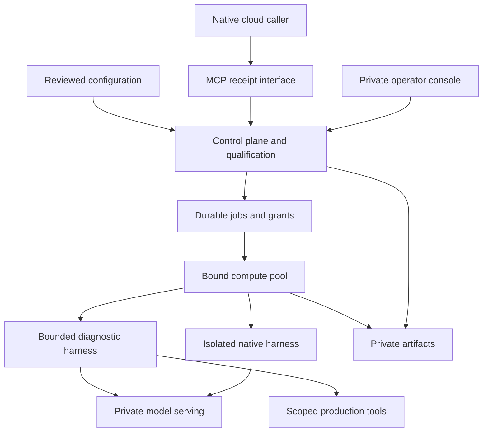

# Sovite — a provisioned platform for mixed model and agent estates

19 October 2026 · revised from the Tulli proposal

## Product decision

Build the complete operating platform and assess it through sustained use. The release includes serving bindings, native and specialist harnesses, agent packages, compute placement, private state, delegation, qualification, operational controls and an operator console. Installation, configuration changes, failure handling and recovery belong to the product from the outset.

The useful question is whether operating this installation improves the work: can a native cloud assistant delegate restricted tasks to a capable private agent, can the operator understand and change the resolved setup, and can the system retain its boundaries through an outage or replacement? Individual checks support that assessment. They do not determine the product's initial scope.

After using the whole, remove components whose operational contribution does not justify their maintenance. Preserve their interfaces and exportable state so simplification does not require rebuilding the estate.

## Name

**Sovite Platform** is the working name. The fitting between parts is the central product idea: a model, serving engine, harness, agent package, host and policy can be selected independently, then bound into an explicit operating combination.

Tulli described the flow-control responsibility well, but made customs and crossings sound like the whole product. The revised platform also provisions workloads, manages their lifecycle and supports day-to-day operations. Telakka and Laituri were considered for their assembly and infrastructure meaning; both have adjacent public Docker tooling names. Sovite also has existing software uses, so the working name is an architectural choice rather than a claim to an available public brand or package namespace.

The display name is configurable. The source package, command and environment prefix in this release are `sovite`, `sovite` and `SOVITE_`.

## Thesis

Sovite assembles a mixed agent estate from replaceable packages and owns the resolved deployment and operating contract. It keeps the native harness visible, treats information placement as a first-class constraint, and gives operators a complete workflow for installing, changing, observing and recovering the system.

A cloud caller can keep its native Codex environment. It delegates a bounded task through MCP to a private agent whose model, tools, execution and state remain within the approved environment. The private result is available to an authenticated operator. The caller receives an independent receipt and a small status vocabulary.

A specialist Kubernetes agent is another package in the same installation. Its model can be fine-tuned or general-purpose, and its harness can be independently developed. The platform records the actual combination, restricts its declared tool authority and directs work to its configured compute pool. Model competence remains something to establish against the intended task.

## The separation to preserve

The data-platform analogy is useful because durable state and replaceable execution have different lifecycles. The database and artifact store outlive API instances, worker processes and model-serving pods. A serving pool can be replaced without moving the job ledger. An agent package can change without owning the GPU scheduler. A native caller does not need to adopt the private agent's harness.

Some layers remain coupled by their interfaces. A model's tool behavior affects the harness; a serving API must preserve the protocol the harness uses; memory and context requirements constrain compute placement. Sovite exposes those dependencies and qualifies resolved combinations. It does not promise that arbitrary combinations behave equivalently.

| Package or binding | Independently configured content | Compatibility that must remain explicit |
| --- | --- | --- |
| Model | Identifier, content digest, model name, parameters and identity endpoint | Context requirements, tool behavior, reasoning behavior and intended task quality |
| Serving | Adapter, protocol, endpoint and destination | Streaming and continuation semantics; model identity behind the endpoint |
| Harness | Kind, image/digest, version, capability declarations and service interface | Native tools, state lifecycle, cancellation and provider protocol |
| Agent | Harness/model references, instructions, allowed tools and execution bounds | The actual procedure and authority available to the agent |
| Compute | Pool identity, deployment kind, namespace and resource profile | Available resources, isolation and destination clearance |
| State | Database and artifact-store placement | Durability, privacy, recovery and qualification binding |
| Flow grant | Caller, agent, class, compute, destinations and return behavior | Current authority at admission, execution and release |

Model weights remain in the serving system's managed cache or provisioned model volume. Workload images use normal container packaging. The first release records those bindings and verifies supported model identities; it does not provide a second general-purpose OCI registry implementation.

## Release architecture



The diagram describes responsibilities. A local assessment can place several services on one host; the private distribution separates them into services or pods. Placement claims become meaningful only when the target's actual resources and network controls have been observed.

### Control plane

The control API imports a validated `PlatformBundle` into durable revision storage. It exposes the operator application and a deliberately small caller surface. The database holds jobs, leases, configuration revisions, runtime inhibits, sessions, qualifications and audit records. Private result bodies are stored through a filesystem or S3 backend.

The resolved job snapshot includes its grant, agent, model, harness, tools, compute and destinations. A canonical generation digest covers the declared bundle. Signed qualifications also bind nonsecret runtime settings, including the actual database target, artifact placement, public origin and security settings. Moving those services invalidates an existing qualification. Credential rotation does not require recording secrets in the evidence.

The implementation uses a shared database-backed job queue and transactional state transitions. Workers claim only their configured compute pool. A lease prevents a late or duplicate worker from publishing a result after ownership has moved. Jobs are claimed oldest first, but a model's `max_concurrency` caps how many of its jobs run at once; a worker passes over a job whose model is at its limit and takes the next job for another model. With more than one worker, a slow model therefore cannot hold every worker while jobs for a faster model wait. On PostgreSQL, claims serialize on an advisory lock so concurrent workers cannot both see the same free slot.

### Execution plane

Ollama provides local model serving. The diagnostic harness implements a bounded tool-calling procedure over configured model endpoints and an explicit tool allowlist. The native Codex harness runs the maintained CLI in a separate service with a fixed agent and provider binding, its own small durable execution ledger and no control-plane database, artifact or operator credentials.

The agent's `max_steps` setting bounds iterations in the diagnostic `tool-agent` harness. Native Codex retains its own internal task loop; Sovite bounds that execution with service and job timeouts, lease renewal and cancellation. Sovite does not enforce a native CLI turn count.

An external agent can implement the HTTP task contract and retain its own internal harness. It receives a task identity, fixed agent identity, configuration revision and task input. Configuration-selected endpoints, authentication references and cancellation behavior remain explicit. Completed output returns to the private worker; the public caller never receives the external agent's internal task interface.

The release includes direct, namespace-scoped Kubernetes read operations and a fixed-endpoint HTTP tool adapter. It does not expose an arbitrary Kubernetes command tool. A production read can contain restricted data even if its API verb is read-only; tool arguments and results both participate in the class calculation.

### Operator experience

The console provides eight connected views: overview, deployments, component catalog, grants, tasks, receipts, qualifications and audit. It shows configured bindings, observed worker activity and current authority separately. A deployment revision is a configuration fact; it is not rendered as proof that a Kubernetes rollout has completed.

The operator can submit and cancel work, inspect a job's resolved combination, deliberately open its private result, inhibit or resume a grant, and inspect the evidence and audit records supporting the current state. Full artifacts are not fetched automatically when opening a task view.

Desired configuration is changed through a validated bundle and deployment tooling. Runtime inhibit/resume is a separate operational write path. An inhibit can reduce authority immediately; clearing it cannot override a disabled grant or a missing current qualification.

## Configuration contract

The release uses one strict `PlatformBundle` with arrays of identified objects. The schema rejects unknown fields, duplicate identifiers, unresolved references and unsupported return or outage modes. YAML duplicate keys are also rejected.

| Object | Responsibility |
| --- | --- |
| Data class | Define an explicit ordered information ladder |
| Destination | Declare a receiving site's clearance, kind and exact host bindings where applicable |
| Model | Bind a model identity to its serving protocol and inference destination |
| Harness | Describe a native, bounded or externally deployed execution package |
| Tool | Declare allowed operations, argument/result classes and destination |
| Agent | Bind instructions, harness, model and tools |
| Compute | Name the worker pool and its deployment placement |
| Grant | Authorize particular callers and an agent at particular classes and sites |
| Profile | Describe the composition of an installed environment |

The reference class ladder is C0 public, C1 operational metadata, C2 confidential and C3 restricted production data. Tool results can raise the effective context class. The output declaration must dominate the input and tool-result classes. The model, compute and private state destinations must be cleared for that context. Each tool must also be permitted to receive the agent's arguments.

This release supports a reference return contract. The caller receives only a server-generated receipt and a fixed status. Typed field declassification and prose return contracts are separate future capabilities; they are not enabled by accepting a label in configuration.

```yaml
apiVersion: sovite.platform/v1alpha1
kind: PlatformBundle
# Other package definitions omitted in this explanatory fragment.
grants:
  - id: incident-forensics
    agent: incident-review
    callers: [cloud-codex, operations]
    input_class: C3
    output_class: C3
    compute: local
    state_destination: private-state
    telemetry_destination: operations
    telemetry_class: C1
    receipt_class: C1
    caller_clearance: C1
    return_contract: reference
    enabled: true
    on_outage: queue
    max_attempts: 3
    timeout_seconds: 600
```

The actual examples are complete validated files: `platform.local.yaml`, `platform.ollama.yaml` and `platform.kubernetes.yaml`.

## Information and authority boundaries

The public receipt is independent from the private job identity. It is not a bearer capability for reading the artifact. Receipt lookups authenticate the caller and recheck current authority. The operator interface requires a separate role and can access private results inside the approved operator environment.

The receipt interface implements an explicit MCP method and tool allowlist. It does not expose private task-result methods, resources, sampling, arbitrary notifications or model-generated errors. Reference-only behavior applies to all supported outward result paths. A transport task handle is not assumed to be a safe receipt: task protocols can carry full results and other payloads.

Each enforcement point has its own duty. Application checks bind identity and current grants. The artifact store holds private bodies. The native service isolates its execution identity from the control plane. Kubernetes network rules constrain reachable destinations. Qualification verifies trusted evidence over declared and runtime bindings. These duties complement one another; a signature does not enforce networking and a network rule does not authorize a receipt.

The Kubernetes distribution denies ingress and egress by default, then permits the declared service relationships. Cilium DNS rules allow exact required names. Model staging has a separate lifecycle from inference; runtime model services have no general registry or cloud-inference route. Tool services and external state need corresponding site-specific rules and evidence.

Bounded statuses still carry information through existence and timing. Receipt-only output reduces the explicit payload surface; it does not prove the absence of every covert channel. The trusted control plane and operator remain within the security boundary.

## End-to-end operating workflows

### Native caller delegates private work

The caller submits a task under an allowed grant. Admission checks identity, current class constraints, runtime inhibits and qualification. The control plane creates an idempotent durable job and a separate receipt. A worker claims it in the configured pool and rechecks authority before outbound model or tool requests.

The agent runs against the private model and declared tools. The worker persists the full artifact and its content hash. A transaction then rechecks current authority, records the public projection and appends audit events. Only after that transaction can an available receipt be observed. The operator opens the full artifact through the private API.

The recorded event means release was authorized and persisted. It does not assert that a remote client received a particular network response.

### An agent or model changes

A reviewed bundle changes the relevant package references or settings. The compiler validates its complete reference graph. The operator activates the new generation and collects qualification for its actual installation. Work bound to a superseded generation is blocked or receives cancellation intent; it does not silently continue against the new model or tool set.

The current implementation uses a whole-bundle generation. Even a small bundle edit can require requalification of the installation. That provides a simple, reviewable boundary for assessment. More granular qualification can be introduced if routine operation shows that this cost is material.

An application database transaction is not an atomic rollout of all cluster enforcement points. Deployment tooling stages the reviewed resources and records their binding; live deployment checks establish that the intended identities and policies are active before enforced work is qualified.

### The local model becomes unavailable

No fallback route is created. The worker records a bounded upstream error and moves eligible work into retry wait. Attempts and timeout limits prevent an indefinite invisible queue. The operator sees the failure and its configured recovery behavior.

If an external agent or potentially mutating tool may already have executed, an uncertain result does not trigger blind replay. The job remains blocked or failed with a fixed uncertainty code. Safe retries depend on a real idempotency guarantee or an explicitly read-only procedure.

### Authority is withdrawn during execution

An operational inhibit blocks new dispatch and marks active work for cancellation. Workers reauthorize at mediated outbound requests, lease renewal and release. Internal provider calls made by the separate native CLI are governed by the service boundary, periodic renewal and cancellation; they do not individually invoke the worker's authorization callback. External cancellation is a bounded best-effort request; an unreachable service may continue until its own timeout. The independent release check still prevents its result becoming publicly available.

Runtime inhibits survive configuration reloads. Restoring a backup inhibits all grants before reopening dispatch. Review desired policy, current trust, state placement and workload evidence before resuming. A policy rollback is an authority change that needs review; it is not an automatic instruction to clear an inhibit.

### A worker or installation is replaced

Job state and artifacts remain outside the worker process. A replacement worker can recover expired leases for safe procedures. A late original worker cannot publish under a lease it no longer owns. External execution with unknown effect status is preserved as uncertain.

The Compose backup tooling stops configured writers, captures database and artifact state, records hashes and preserves the prior running-service set. Restore verifies the archive and applies a recovery lock. Kubernetes installations use the target's PostgreSQL, object-store and CSI recovery mechanisms; the platform's contracts and state do not require adopting a new cluster backup system.

## Provisioned release

| Profile | Components and use |
| --- | --- |
| Local | Full console, control API, independent worker, SQLite, private filesystem artifacts, signed development qualification and explicit synthetic inference |
| Private Compose | Control, worker, PostgreSQL, Garage, Ollama, model staging, private networks and optional isolated native Codex service |
| Kubernetes | The same responsibilities as separately configured workloads, resource budgets, persistence, probes, scoped tool RBAC, default-deny rules, Cilium DNS controls and private ingress |

The profiles replace infrastructure bindings while retaining the operating model and UI. The source distribution contains installation, validation, image-locking, model-staging, qualification, export and recovery tooling.

The bundled state services are a reference installation. A site can supply its existing PostgreSQL, S3, ingress, storage classes and secret delivery. Secrets are injected as runtime references and are not included in source or qualification payloads. The optional deployment binding includes reviewed manifest and configuration identity; qualification still needs evidence from the actual target.

## Adopt and extend deliberately

The implemented release adopts ordinary serving, storage and deployment components. It supplies adapters where an existing runtime already owns useful behavior. Native Codex remains a maintained external CLI; specialist agents can remain separately deployed services.

The broader ecosystem remains relevant. KServe/llm-d can own larger serving pools, kagent can own an agent estate, and ToolHive/agentgateway can own MCP tool infrastructure. KitOps can own model artifact packaging. These are integration options with their own lifecycle and compatibility work. This source release does not claim an implemented controller or qualified adapter for every product in the earlier adopt map.

Sovite's product value is the installed combination: consistent package bindings, explicit information placement, durable private work, usable operations and evidence that remains intelligible when an upstream component changes. A provider catalog or a YAML wrapper alone does not establish that value.

## Whole-platform assessment

Assess the release through representative work and operating events. Keep capability, security, reliability and operator effort visible as separate outcomes.

| Scenario | What the complete installation should establish |
| --- | --- |
| Cloud-to-private incident delegation | Native caller remains useful; restricted tools/model/results stay in the intended environment |
| Private Kubernetes diagnostics | Allowed reads produce evidence useful to an operator, with no undeclared namespace or resource authority |
| Native code review | Actual CLI, model protocol, workspace tools and continuation behavior work together |
| Model replacement | Identity and configuration changes are visible, qualified and recoverable |
| Compute replacement | Durable work survives an execution-host change without granting a late worker release authority |
| Outage and cancellation | The operator understands queue and uncertainty states; no destination fallback occurs |
| Mid-run inhibit | Current authorization prevents further approved boundaries and public release as designed |
| Backup and restore | State can be recovered and authority is deliberately re-established |
| Routine operator work | The console and deployment tooling reduce the effort of understanding and changing the estate |
| Component removal | A component can be removed without losing durable work, evidence or the required interfaces |

The release report records actual execution evidence and remaining site-dependent checks. A successful small task is not a model-competence benchmark. Rendered network policy is not observed packet enforcement. A signed result records what the trusted issuer attested; it does not convert an unrun check into a passing one.

## Vuoro relationship

The earlier mapping remains useful, with a broader operating scope. FlowGrant governs information access and destinations; EffectGrant governs actions. Recipe and agent-profile revisions describe resolved packages. Qualifications map to experiments and evidence sets. Durable task state can feed a shared work queue, and the audit projection can feed an existing evidence stream or cockpit.

Those mappings describe integration boundaries. This release does not write to a Vuoro service or modify its contracts. A later integration should preserve the existing system's source of truth and identity model, while replacing duplicate state only when the complete workflow remains useful.

## Reference sources

- [Codex advanced configuration](https://learn.chatgpt.com/docs/config-file/config-advanced) and [gateway compatibility](https://learn.chatgpt.com/docs/enterprise/gateway-compatibility): provider and native harness requirements.
- [Ollama API](https://docs.ollama.com/api/introduction) and [OpenAI compatibility](https://docs.ollama.com/api/openai-compatibility): adopted serving interfaces and their limits.
- [MCP HTTP transport](https://modelcontextprotocol.io/specification/2025-11-25/basic/transports) and [Tasks extension](https://tasks.extensions.modelcontextprotocol.io/specification/2026-07-28/tasks): explicit transport and result surfaces.
- [Cilium DNS policy](https://docs.cilium.io/en/stable/security/dns/): DNS and destination enforcement responsibilities.
- [kagent core concepts](https://www.kagent.dev/docs/kagent/1.x/about/core-concepts/) and [KServe configuration composition](https://kserve.github.io/website/docs/model-serving/generative-inference/llmisvc/llmisvc-config-composition): adjacent adopted-platform concepts.
- [FIDES](https://arxiv.org/html/2505.23643v2): information-flow reasoning and remaining implicit channels.

Implementation details and verification evidence are authoritative in the accompanying source release and `RELEASE-READINESS.md`.
